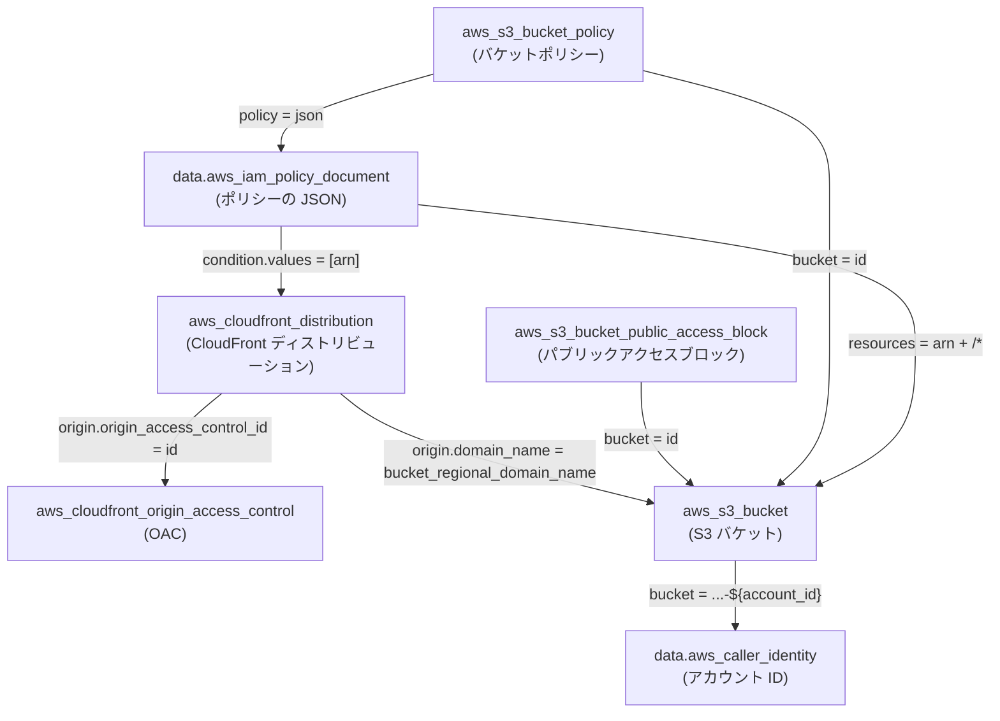
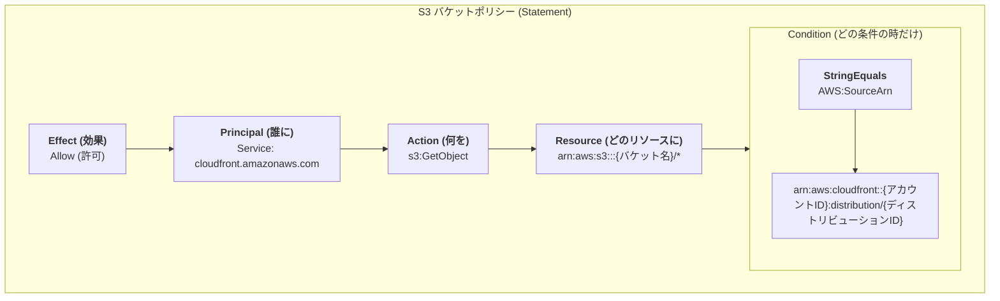

# Phase 1 学習ログ

## 決定事項と判断理由

| 論点 | 決定 | 理由 |
| --- | --- | --- |
| ドメインと証明書 | CloudFront のデフォルトドメインと既定の証明書 | 証明書の発行と DNS の設定が要らない。独自ドメインは発展課題 |
| アクセス制限 | かけない。配信するのはサンプルの SPA に限る | 認証や IP 制限には WAF や Lambda@Edge が要り、Phase 1 の範囲外 |
| 存在しないパス | SPA の 404 画面を表示し、ステータスは 200 | 社内向けで、検索エンジンに載らない |
| 存在しないパスの処理 | `custom_error_response` で、オリジンの 403 を `/index.html` と 200 に置き換える | CloudFront Functions を使わずに SPA ルーティングを実現する |
| S3 への読み取り | OAC。バケットポリシーで `cloudfront.amazonaws.com` に `s3:GetObject` を許し、`AWS:SourceArn` でこのディストリビューションに限る | 条件がないと、他のアカウントの CloudFront からも読める |
| セキュリティヘッダー | マネージドの SecurityHeadersPolicy | ヘッダーの自作は Phase 1 の主題ではない |
| `index.html` のキャッシュ | ブラウザは `no-cache`、CloudFront はキャッシュしない | デプロイのたびに中身が変わり、ファイル名は変わらない |
| `/assets/*` のキャッシュ | ブラウザは `public, max-age=31536000, immutable`、CloudFront もキャッシュする | ファイル名にハッシュが入り、中身が変わると URL が変わる |

## 学んだこと

### 参照の向き

`A --> B` は、A の引数が B の属性を参照することを表す。

バケットポリシーの中身:

- CloudFront はバケット(`bucket_regional_domain_name`)と OAC(`id`)を参照する
- バケットポリシーは、`aws_iam_policy_document` を経由して CloudFront の ARN とバケットの ARN を参照する
- バケットポリシーがバケットとは別のリソースなので、参照が循環しない。作成はバケット → CloudFront → バケットポリシーの順になる

### OAC と 403

- S3 は、`s3:ListBucket` を許していない相手には、存在しないキーにも 404 ではなく 403 を返す。存在しないことすら教えない
- そのため、SPA の深いパスも存在しないパスも、オリジンからはどちらも 403 として返ってくる

### デプロイ直後に新しい画面が出る理由

- `index.html` はブラウザも CloudFront もキャッシュしないため、常に最新のものが取得される
  - `no-cache` は「保存してよいが、使う前に毎回オリジンに確かめる」という意味。保存そのものを禁じるのは `no-store`
- 新しい `index.html` は新しいハッシュ付きのファイル名を参照する。ブラウザにとっては初めての URL なので、古いアセットのキャッシュは使われない
- `immutable` は再検証を省く指示で、有効期限は決めない。期限は `max-age` で決める

### `data` と `resource`

- `resource` は AWS にものを作り、Terraform が管理する。`data` は作らずに値を得るだけで、destroy しても何も起きない
- data source の値は plan の時点で確定する。これから作る resource の属性は `(known after apply)` になる
- `aws_iam_policy_document` は AWS に問い合わせず、provider が手元で JSON を組み立てる
- `aws_s3_bucket_policy` のように、同じ名前が `resource` と `data` の両方にあることがある。data の `policy` は読んだ結果を入れる属性なので、指定すると `Value for unconfigurable attribute` になる

### バケットポリシーの効き方

- バケットポリシーがない状態では、CloudFront 経由のリクエストも S3 が 403 `AccessDenied` で拒否する。応答の `server: AmazonS3` と S3 形式の XML から、拒否したのが S3 だと分かる
- バケットポリシーを足すと CloudFront 経由は 200 になり、S3 への直接アクセスは 403 のまま
- `AWS:SourceArn` には、リクエスト元のディストリビューションの ARN が入る。`values` はリソースの `arn` 属性を参照して書く
- レスポンスヘッダーポリシーのヘッダーは、エラー応答にも付く

### plan の `~` は「変わるかもしれない」を含む

- data source が、変更予定のあるリソースを参照していると、読み取りが apply まで遅れる(`will be read during apply`)
- その data source を使うリソースは、値が `(known after apply)` になり `~` と表示される。実際の値が変わらなければ、apply 後の plan は `No changes` になる

### アップロードの順番と `custom_error_response` の副作用

- `custom_error_response` はディストリビューション全体に効く。存在しないアセット(`/assets/no-such.js`)も、`index.html` が `200` と `text/html` で返る
- そのため、`index.html` を先に上げると、新しいアセットがまだない間、ブラウザは HTML を JavaScript として受け取って画面が壊れる。404 にならないので気づきにくい
- アセット → `index.html` の順に上げる。古い `index.html` を開いたままの利用者が古いアセットを取りに来るので、`sync --delete` で古いアセットを消さない
- 深いパスの応答は `x-cache: Error from cloudfront` になる。オリジンの 403 を CloudFront が差し替えたことが分かる

### 命名とファイル分割の規則

HashiCorp の Terraform Style Guide に従う。

- 名前は説明的な名詞にし、単語は `_` で区切る(`web_api`)
- 名前にリソースの型を繰り返さない。アドレス(`aws_s3_bucket.this`)に型が既に含まれる。ディレクトリで分かること(`phase1`)も繰り返さない
- その型のリソースが 1 つしかなければ `this` にする。AWS provider の公式 module(terraform-aws-modules)の慣習
- 同じ型が複数あるときは、役割で名前を付ける(`caching_disabled` / `caching_optimized`)
- ファイルは `terraform.tf`(`required_version` と `required_providers`)/ `providers.tf` / `main.tf` / `variables.tf` / `outputs.tf` / `locals.tf` に分ける
- リソースが増えたら、`main.tf` を論理的なまとまり(`network.tf`、`storage.tf` など)に分ける。基準は、目的のリソースがどのファイルにあるかがすぐ分かること

## Console で見たもの

- ディストリビューションのオリジンの編集画面では、OAC を作成済みのものから選ぶ。Terraform で作った `learn-aws-iaas-phase1` も一覧に出る
- OAC はディストリビューションに属さない、アカウント単位の独立したリソース。複数のディストリビューションで使い回せる。Terraform でも、ディストリビューションとは別の `aws_cloudfront_origin_access_control` として書く

## 検証

| 確かめたこと | 結果 |
| --- | --- |
| CloudFront 経由の `/`、`/settings/profile`、`/no-such-page` | 200。深いパスと存在しないパスでは SPA がそれぞれの画面を表示する |
| http でのアクセス | 301 で https へ |
| S3 への直接アクセス | 403 |
| `/assets/*` のキャッシュ | 2 回目以降に `x-cache: Hit` になり、`age` が増える |
| `index.html` のキャッシュ | 毎回 `x-cache: Miss` |
| バケットポリシーなし | CloudFront 経由も 403(`server: AmazonS3`) |
| `AWS:SourceArn` を別のディストリビューションの ARN にする | `/` は 403。`/assets/*` はエッジのキャッシュから 200 のまま |

- 200 が返ることは「許可されている」ことしか示さない。条件の値をわざと外して 403 になることを見て、許可を絞れていることを確かめる
- オリジンの設定を確かめるときは、CloudFront にキャッシュされないパスを使う。キャッシュが残っている間は、オリジンを壊しても利用者からは正常に見える
- `custom_error_response` の差し替え用の `/index.html` も、オリジンから同じ権限で取得する。それも拒否されると、403 がそのまま返る

## 振り返り

### 今回作ったもの

Vite でビルドした SPA を、CloudFront のデフォルトドメインから HTTPS で配信する基盤。S3 は OAC 経由でだけ読め、直接のアクセスは拒否する。深いパスと存在しないパスは `custom_error_response` で `index.html` を返し、`/assets/*` だけを CloudFront とブラウザに長くキャッシュさせる。

### コードの構成

`versions.tf` / `providers.tf` / `s3.tf` / `cloudfront.tf` / `output.tf` に分けた。バケットとバケットポリシーは `s3.tf`、OAC とディストリビューションは `cloudfront.tf` に置く。

### 難しかった点

- Terraform の書き方・設計がまだ手に馴染んでいない
- Phase 0 では `main.tf` に全てを記述していたのを `cloudfront.tf` / `s3.tf` に分割したが、両ファイルが相互参照しているため複雑感が増している。ファイルが 2 つだからまだ何とか理解できるが、更にリソースが増えると理解が追いつかなくなりそう
  - Terraform は、同じディレクトリの `.tf` ファイルをすべて 1 つのモジュールとして読む。ファイルの分け方と並び順は、Terraform の動作には影響しない。依存関係を決めるのは参照だけ
  - ES Modules のように、ファイルごとにスコープや `import` があるわけではない。全ファイルを連結した 1 つのファイルに近い
  - 依存関係は `terraform graph` で図にできる。入力と出力を明示した境界(module)は Phase 3 で扱う

### 作り直すなら改善したい点

- `ordered_cache_behavior` の `compress` を `true` にする。plan では `compress = false` になっていて、JavaScript と CSS が圧縮されずに配信される
- アップロードの 3 つのコマンドを 1 つのスクリプトにまとめる。アセット → `index.html` の順番を、手順書ではなくスクリプトで守らせる。Phase 4 で CI に載せるときの土台になる

### 次に学ぶこと

通信経路を自分で組み立てる VPC とネットワーク(Phase 2)。
