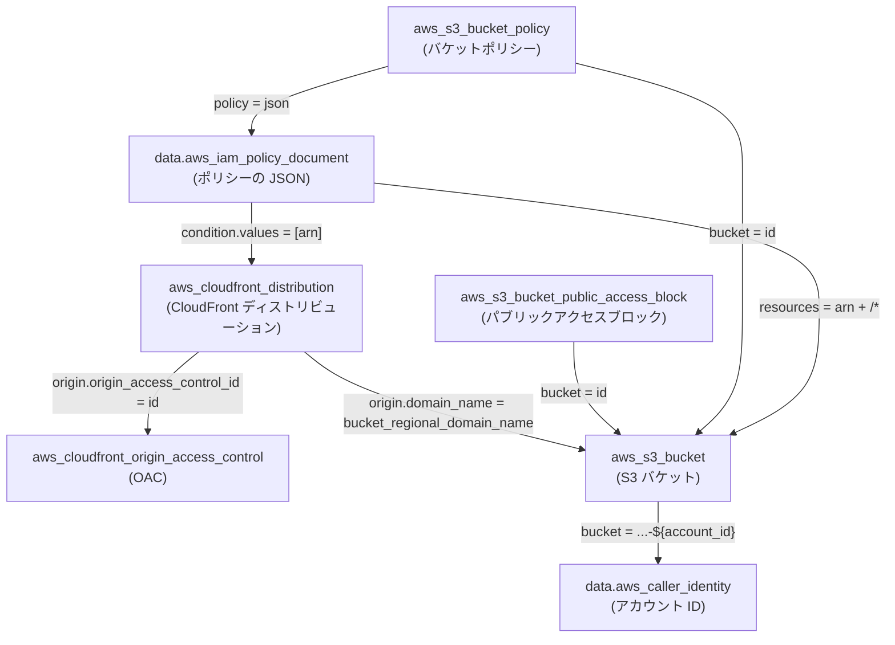
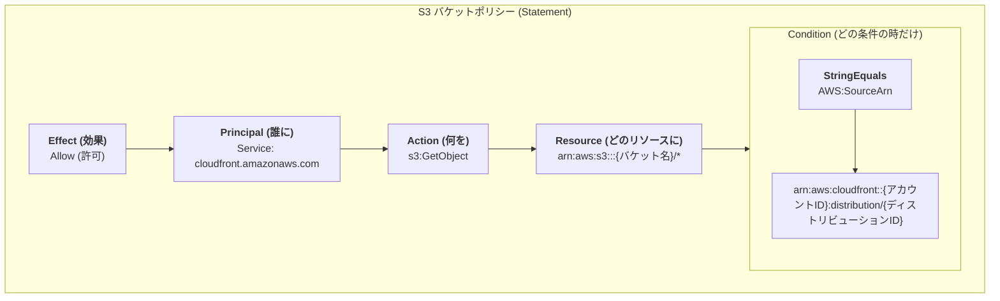

# Phase 1 学習ログ

## 決定事項と判断理由

| 論点 | 決定 | 理由 |
| --- | --- | --- |
| ドメインと証明書 | CloudFront のデフォルトドメインと既定の証明書 | 証明書の発行と DNS の設定が要らない。独自ドメインは発展課題 |
| アクセス制限 | かけない。配信するのはサンプルの SPA に限る | 認証や IP 制限には WAF や Lambda@Edge が要り、Phase 1 の範囲外 |
| 存在しないパス | SPA の 404 画面を表示し、ステータスは 200 | 社内向けで、検索エンジンに載らない |
| 存在しないパスの処理 | `custom_error_response` で、オリジンの 403 を `/index.html` と 200 に置き換える | CloudFront Functions を使わずに SPA ルーティングを実現する |
| S3 への読み取り | OAC。バケットポリシーで `cloudfront.amazonaws.com` に `s3:GetObject` を許し、`AWS:SourceArn` でこのディストリビューションに限る | 条件がないと、他のアカウントの CloudFront からも読める |
| セキュリティヘッダー | マネージドの SecurityHeadersPolicy | ヘッダーの自作は Phase 1 の主題ではない |
| `index.html` のキャッシュ | ブラウザは `no-cache`、CloudFront はキャッシュしない | デプロイのたびに中身が変わり、ファイル名は変わらない |
| `/assets/*` のキャッシュ | ブラウザは `public, max-age=31536000, immutable`、CloudFront もキャッシュする | ファイル名にハッシュが入り、中身が変わると URL が変わる |

## 学んだこと

### 参照の向き

`A --> B` は、A の引数が B の属性を参照することを表す。

バケットポリシーの中身:

- CloudFront はバケット(`bucket_regional_domain_name`)と OAC(`id`)を参照する
- バケットポリシーは、`aws_iam_policy_document` を経由して CloudFront の ARN とバケットの ARN を参照する
- バケットポリシーがバケットとは別のリソースなので、参照が循環しない。作成はバケット → CloudFront → バケットポリシーの順になる

### OAC と 403

- S3 は、`s3:ListBucket` を許していない相手には、存在しないキーにも 404 ではなく 403 を返す。存在しないことすら教えない
- そのため、SPA の深いパスも存在しないパスも、オリジンからはどちらも 403 として返ってくる

### デプロイ直後に新しい画面が出る理由

- `index.html` はブラウザも CloudFront もキャッシュしないため、常に最新のものが取得される
  - `no-cache` は「保存してよいが、使う前に毎回オリジンに確かめる」という意味。保存そのものを禁じるのは `no-store`
- 新しい `index.html` は新しいハッシュ付きのファイル名を参照する。ブラウザにとっては初めての URL なので、古いアセットのキャッシュは使われない
- `immutable` は再検証を省く指示で、有効期限は決めない。期限は `max-age` で決める

### `data` と `resource`

- `resource` は AWS にものを作り、Terraform が管理する。`data` は作らずに値を得るだけで、destroy しても何も起きない
- data source の値は plan の時点で確定する。これから作る resource の属性は `(known after apply)` になる
- `aws_iam_policy_document` は AWS に問い合わせず、provider が手元で JSON を組み立てる
- `aws_s3_bucket_policy` のように、同じ名前が `resource` と `data` の両方にあることがある。data の `policy` は読んだ結果を入れる属性なので、指定すると `Value for unconfigurable attribute` になる

### バケットポリシーの効き方

- バケットポリシーがない状態では、CloudFront 経由のリクエストも S3 が 403 `AccessDenied` で拒否する。応答の `server: AmazonS3` と S3 形式の XML から、拒否したのが S3 だと分かる
- バケットポリシーを足すと CloudFront 経由は 200 になり、S3 への直接アクセスは 403 のまま
- `AWS:SourceArn` には、リクエスト元のディストリビューションの ARN が入る。`values` はリソースの `arn` 属性を参照して書く
- レスポンスヘッダーポリシーのヘッダーは、エラー応答にも付く
